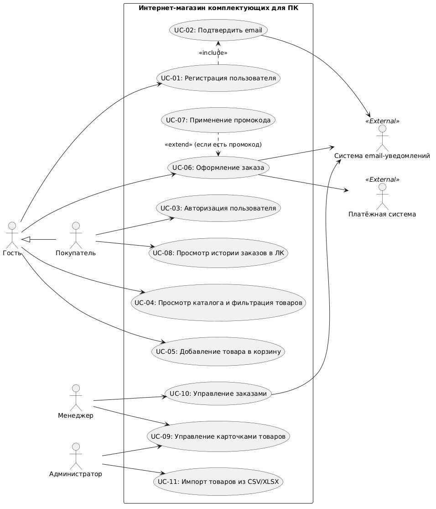
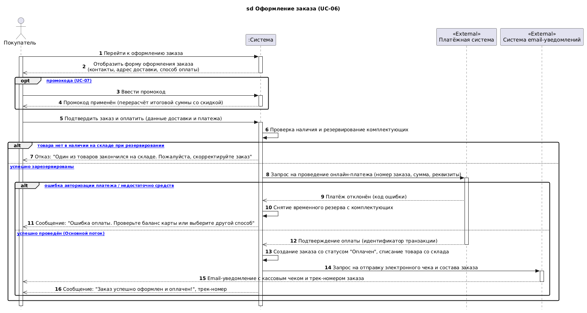

# Общий отчет по проекту «Интернет-магазин комплектующих для ПК»

**Дисциплина:** Программная инженерия  
**Группа:** ДЭ 25-24  
**Команда:** Мурзаковский Даниил, Юсупов Айдар  
**Преподаватель:** Храмов Д.Э.  

> **Статус документа Word (`report.docx`):** Сверена с Markdown перед сдачей (актуальна).  
> **Основная Word-версия отчета для сдачи:** [report.docx](report.docx)  
> **Индивидуальные отчеты участников:**
> - Мурзаковский Даниил: [Markdown-отчет](md/murzakovskiy-report.md) | [Word-отчет (doc)](doc/murzakovskiy-report.docx) (Сверен перед сдачей)
> - Юсупов Айдар: [Markdown-отчет](md/yusupov-report.md) | [Word-отчет (doc)](doc/yusupov-report.docx) (Сверен перед сдачей)

---

## Оглавление

1. [Введение, цели и границы системы](#1-введение-цели-и-границы-системы)
2. [Требования к программному продукту (ПЗ № 1)](#2-требования-к-программному-продукту-пз--1)
3. [Спецификация вариантов использования (ПЗ № 2)](#3-спецификация-вариантов-использования-пз--2)
4. [UML-диаграммы: Use Case и диаграммы последовательностей (ПЗ № 3)](#4-uml-диаграммы-use-case-и-диаграммы-последовательностей-пз--3)
5. [Организация проектного репозитория Git (ПЗ № 4)](#5-организация-проектного-репозитория-git-пз--4)
6. [Сводная таблица индивидуального вклада участников](#6-сводная-таблица-индивидуального-вклада-участников)
7. [Выводы по проделанной работе](#7-выводы-по-проделанной-работе)

---

## 1. Введение, цели и границы системы

Целью проекта является проектирование и разработка масштабируемой программной платформы электронной коммерции «Интернет-магазин комплектующих для ПК», ориентированной на розничных клиентов, сборщиков персональных компьютеров и энтузиастов.

### Границы системы:
Система охватывает веб-приложение интернет-магазина, обеспечивающее пользователям просмотр каталога, подбор, корзину, оформление заказов и отслеживание статусов, а административно-управленческому персоналу — управление номенклатурой, складскими остатками и заказами.
Внешними по отношению к системе являются пользователи (Гость, Покупатель, Менеджер, Администратор) и внешние сервисы (Платёжная система для онлайн-эквайринга и Сервис email-рассылок для отправки чеков и кодов верификации). Внутренняя СУБД входит в границы системы и внешним актором не является.

---

## 2. Требования к программному продукту (ПЗ № 1)

### 2.1. Роли пользователей:
1. **Гость:** неавторизованный посетитель сайта. Доступен каталог, фильтрация, добавление в корзину, оформление заказа, регистрация.
2. **Покупатель:** зарегистрированный клиент. Доступны возможности гостя, а также личный кабинет, история заказов, персональные промокоды.
3. **Менеджер:** сотрудник магазина. Просмотр заказов, смена статусов, резервирование, связь с покупателем.
4. **Администратор:** административный доступ. Управление каталогом товаров, ценами, категориями, пакетный импорт из CSV/XLSX, управление ролями.

### 2.2. Функциональные требования:
- **ФТ-01:** Регистрация новых пользователей в системе.
- **ФТ-02:** Подтверждение адреса электронной почты через проверочный код/ссылку.
- **ФТ-03:** Авторизация пользователя (вход по email и паролю).
- **ФТ-04:** Просмотр каталога комплектующих с многопараметрической фильтрацией (по сокету, чипсету, типу памяти, цене, бренду).
- **ФТ-05:** Добавление товаров в корзину, расчет промежуточной стоимости и управление количеством.
- **ФТ-06:** Оформление заказа с выбором способа доставки и оплатой.
- **ФТ-07:** Применение скидочного промокода при оформлении заказа.
- **ФТ-08:** Просмотр истории и текущего статуса заказов в личном кабинете.
- **ФТ-09:** Управление карточками товаров (добавление, редактирование, деактивация позиций).
- **ФТ-10:** Управление заказами клиентов менеджером магазина.
- **ФТ-11:** Пакетный импорт каталога товаров из файлов CSV/XLSX.

### 2.3. Нефункциональные требования:
- **НФТ-01 (Производительность):** Время отклика страниц каталога не более 1.5 сек. при одновременной работе до 500 пользователей.
- **НФТ-02 (Безопасность):** Хранение паролей в хешированном виде (bcrypt); передача данных строго по HTTPS (TLS 1.3).
- **НФТ-03 (Адаптивность):** Корректное отображение на экранах с шириной от 360px до 4K.
- **НФТ-04 (Надежность):** Ежесуточное резервное копирование базы данных.

---

## 3. Спецификация вариантов использования (ПЗ № 2)

Каждый вариант использования соответствует пользовательской цели и связывается с функциональными требованиями. Подробно специфицированы сценарии:

- `UC-05: Добавление товара в корзину` (автор: Юсупов А.) — описывает шаги проверки наличия на складе, проверки розничного лимита в 10 штук на позицию и обновления хранилища корзины.
- `UC-06: Оформление заказа` (автор: Мурзаковский Д.) — описывает шаги ввода контактов, опциональное применение промокода (`UC-07`), резервирование на складе, взаимодействие с платёжным шлюзом и отправку чека через email-сервис.

---

## 4. UML-диаграммы: Use Case и диаграммы последовательностей (ПЗ № 3)

### 4.1. Общая диаграмма вариантов использования
Диаграмма разработана в PlantUML ([исходник draw/use_case_diagram.puml](draw/use_case_diagram.puml)):



**Обоснование связей:**
- `Покупатель --|> Гость`: отношение обобщения (наследования). Покупатель имеет доступ ко всем публичным сценариям гостя.
- `UC-01 .> UC-02 : <<include>>`: обязательное включение подтверждения email в сценарий регистрации.
- `UC-07 .> UC-06 : <<extend>>`: опциональное расширение оформления заказа при наличии промокода.
- Внешние акторы `Платёжная система` и `Система email-уведомлений` помечены стереотипом `«External»`.

---

### 4.2. Диаграмма последовательностей: UC-05 «Добавление товара в корзину»
Автор: **Юсупов Айдар** ([исходник draw/sd_cart_yusupov.puml](draw/sd_cart_yusupov.puml)):


**Охваченные потоки:**
- **Основной поток:** товар есть на складе, лимит не превышен -> корзина успешно обновлена и сохранена.
- **A1 (Остаток равен 0):** сообщение об отсутствии, предложение листа ожидания.
- **A2 (Превышение лимита более 10 шт):** блокировка добавления с предупреждением о лимите.

---

### 4.3. Диаграмма последовательностей: UC-06 «Оформление заказа»
Автор: **Мурзаковский Даниил** ([исходник draw/sd_order_murzakovskiy.puml](draw/sd_order_murzakovskiy.puml)):



**Охваченные потоки:**
- **Основной поток:** резерв товара -> оплата подтверждена банком -> списание со склада -> отправка чека по email -> заказ успешно оформлен.
- **[opt] UC-07:** ввод промокода и перерасчет суммы.
- **A1 (Товар закончился при резерве):** отказ в оформлении, предложение изменить корзину.
- **A2 (Отказ платежа банком):** снятие временного резерва комплектующих со склада, сообщение об ошибке оплаты.

---

### 4.4. Таблица трассировки (Таблица соответствия)

| Требование | Вариант использования | Диаграмма и потоки | Ответственный автор |
| :--- | :--- | :--- | :--- |
| **ФТ-01** | UC-01 Регистрация пользователей | не строилась в ПЗ № 3 | Команда |
| **ФТ-02** | UC-02 Подтверждение email | не строилась в ПЗ № 3 | Команда |
| **ФТ-03** | UC-03 Авторизация пользователя | не строилась в ПЗ № 3 | Команда |
| **ФТ-04** | UC-04 Просмотр каталога и фильтрация | не строилась в ПЗ № 3 | Команда |
| **ФТ-05** | UC-05 Добавление товара в корзину | SD-01; Основной, A1 (нет остатка), A2 (лимит 10 шт) | Юсупов А. |
| **ФТ-06** | UC-06 Оформление заказа | SD-02; Основной, [opt] промокод, A1 (сбой резерва), A2 (отказ банка) | Мурзаковский Д. |
| **ФТ-07** | UC-07 Применение промокода | SD-02; [opt] Включен в диаграмму SD-02 | Мурзаковский Д. |
| **ФТ-08** | UC-08 Просмотр истории заказов в ЛК | не строилась в ПЗ № 3 | Команда |
| **ФТ-09** | UC-09 Управление карточками товаров | не строилась в ПЗ № 3 | Команда |
| **ФТ-10** | UC-10 Управление заказами | не строилась в ПЗ № 3 | Команда |
| **ФТ-11** | UC-11 Импорт товаров из CSV/XLSX | не строилась в ПЗ № 3 | Команда |

---

### 4.5. Разбор учебных ошибок черновика регистрации

1. **Актор внутри границы системы:** Актор — внешняя сущность. *Исправление:* вынесен за пределы границы.
2. **База данных как внешний актор:** БД — внутренний компонент. *Исправление:* исключена из числа акторов.
3. **Стрелка «потом»:** В UML Use Case нет временных стрелок. *Исправление:* удалена недопустимая стрелка.
4. **Ответ «Создан» до проверки дубликата:** *Исправление:* создание пользователя и ответ перенесены строго внутрь успешной ветви проверки.
5. **Создание кабинета при ошибке:** *Исправление:* создание кабинета исключено из ветви отказа и выполняется только при успехе.

---

## 5. Организация проектного репозитория Git (ПЗ № 4)

Репозиторий проекта развернут на платформе **GitHub** в соответствии с установленным регламентом.

### Структура репозитория:
```
pc-parts-store/
├── README.md                  # Презентация продукта, статус и навигация
├── .gitignore                 # Исключение временных файлов Office, IDE и сборки
├── CONTRIBUTING.md            # Регламент веток, коммитов, PR и ревью
├── source-material/           # Первоначальные задания и регламенты кафедры
├── docs/                      # Документация и отчетность
│   ├── README.md              # Полный общий отчет в формате Markdown
│   ├── report.docx            # Сверенная версия общего отчета в DOCX
│   ├── doc/                   # Индивидуальные отчеты участников (Word)
│   ├── md/                    # Индивидуальные отчеты участников (Markdown)
│   ├── img/                   # Растровые и векторные иллюстрации
│   └── draw/                  # Исходники диаграмм PlantUML (.puml)
├── projects/                  # Исходный код и техническая документация
├── modules/                   # Описание модулей (совместимость, импорт)
├── tests/                     # Методология и регламент тестирования
└── teams/                     # Роли, распределение обязанностей и контакты
```

### Правило синхронизации форматов:
Markdown является первоисточником информации. Документы Word (`docs/report.docx`, `docs/doc/*`) актуализируются перед каждой контрольной сдачей.

---

## 6. Сводная таблица индивидуального вклада участников

| Участник команды | Выполненная часть работы | Размещённые файлы и материалы |
| :--- | :--- | :--- |
| **Мурзаковский Даниил**<br>(`@DanMurs`) | 1. Инициализация репозитория, настройка `.gitignore` и `CONTRIBUTING.md`.<br>2. Разработка сценария и PlantUML диаграммы `UC-06: Оформление заказа` с опциональным промокодом и внешними шлюзами.<br>3. Ведение общего отчета команды `docs/README.md` и сборка общего отчета `docs/report.docx`.<br>4. Проведение взаимной проверки диаграммы корзины. | • `README.md`, `.gitignore`, `CONTRIBUTING.md`<br>• `docs/draw/sd_order_murzakovskiy.puml`<br>• `docs/img/sd_order_murzakovskiy.png`<br>• `docs/md/murzakovskiy-report.md`<br>• `docs/doc/murzakovskiy-report.docx`<br>• `docs/report.docx` |
| **Юсупов Айдар**<br>(`@AidarYusupov`) | 1. Формализация требований к каталогу и корзине комплектующих.<br>2. Разработка сценария и диаграммы последовательностей `UC-05: Добавление товара в корзину` с альтернативами отсутствия остатка и лимита.<br>3. Подготовка индивидуального отчета в форматах Markdown и Word.<br>4. Рецензирование диаграммы оформления заказа (проверка корректности освобождения резерва). | • `docs/draw/sd_cart_yusupov.puml`<br>• `docs/img/sd_cart_yusupov.jpg`<br>• `docs/md/yusupov-report.md`<br>• `docs/doc/yusupov-report.docx`<br>• `teams/README.md` |

---

## 7. Выводы по проделанной работе

В рамках ПЗ № 1–4 сформирована целостная база требований и проектных моделей интернет-магазина комплектующих для ПК. Развернута профессиональная среда командной разработки на основе Git с четким разделением веток, взаимным контролем качества и регламентом ведения документации. Все материалы согласованы и готовы к дальнейшему этапу реализации.
