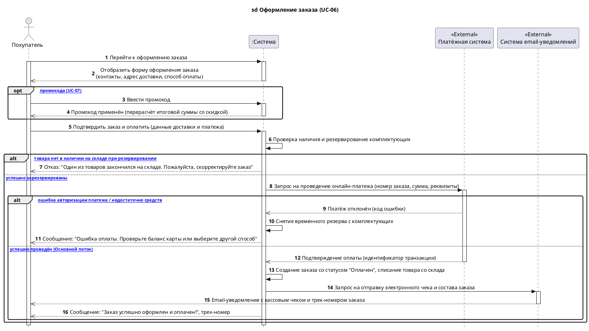

# Индивидуальный отчет участника команды

**Студент:** Мурзаковский Даниил  
**Группа:** ДЭ 25-24  
**Роль в проекте:** Ведущий системный архитектор, Scrum-мастер, разработчик  
**Проект:** Интернет-магазин комплектующих для ПК  
**Статус Word-версии:** Сверена с Markdown перед сдачей ([murzakovskiy-report.docx](../doc/murzakovskiy-report.docx))  

---

## 1. Поставленная задача

1. Разработка архитектурного регламента командной разработки и развертывание проектного репозитория Git с заданной структурой директорий, настройкой `.gitignore` и созданием `CONTRIBUTING.md`.
2. Анализ и формализация функциональных требований `ФТ-06` (Оформление заказа) и `ФТ-07` (Применение промокода).
3. Построение детальной системной диаграммы последовательностей (Sequence Diagram) для варианта использования `UC-06: Оформление заказа` в нотации PlantUML.
4. Моделирование взаимодействия системы с внешними акторами: платёжным шлюзом онлайн-эквайринга и сервисом email-уведомлений.
5. Проектирование альтернативных сценариев обработки сбоев: дефицит товара при резервировании и отказ банка при авторизации платежа (с обязательным снятием резерва).
6. Взаимное рецензирование диаграммы участника Юсупова А. (UC-05).
7. Подготовка и ведение общего отчета `docs/README.md` и сборка итоговых отчетов в формате Word (`report.docx`).

---

## 2. Принятые проектные решения

- **Архитектурный уровень детализации:** Диаграмма последовательностей построена на системном уровне (`:Система`), что исключает преждевременную привязку к внутренним классам и фреймворкам бэкенда на этапе проектирования требований.
- **Взаимодействие со складом:** Резервирование остатков комплектующих выполняется непосредственно перед вызовом платежного шлюза. В случае отклонения транзакции банком система в обязательном порядке отправляет сигнал на снятие временного резерва, что исключает блокировку товарных остатков.
- **Интеграция с промокодами:** Применение купона выделено в опциональный блок `opt`, предшествующий подтверждению оплаты, что строго соответствует связи `<<extend>>` на Use Case диаграмме.
- **Уведомления:** Запрос к почтовому сервису инициируется только после успешного подтверждения транзакции эквайрингом.

---

## 3. Разработанная диаграмма последовательностей (UC-06)

Диаграмма подготовлена в PlantUML ([исходник](../draw/sd_order_murzakovskiy.puml)):

### Листинг PlantUML:

---

## 4. Взаимная проверка и вклад в команду

- Проведено рецензирование диаграммы Юсупова А. (UC-05). Подтверждена полнота условий `alt` для ситуаций нулевого остатка и лимита более 10 единиц в одни руки.
- Создана единая проектная среда Git, обеспечивающая прозрачный контроль версий всех документов.
- Подготовлен согласованный отчет Word `docs/report.docx`.
