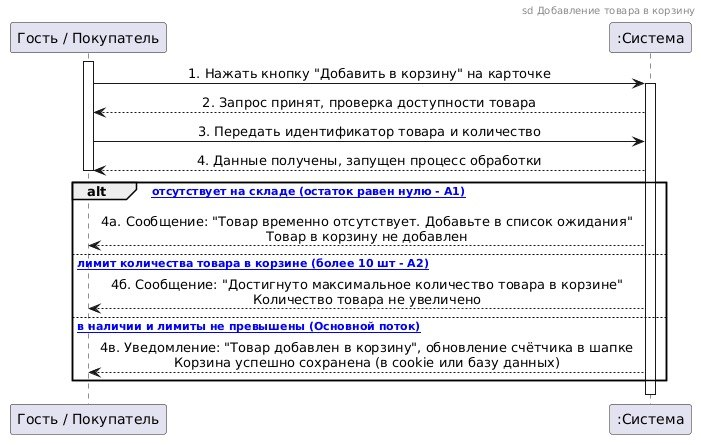

# Индивидуальный отчет участника команды

**Студент:** Юсупов Айдар  
**Группа:** ДЭ 25-24  
**Роль в проекте:** Бизнес-аналитик, Backend-разработчик  
**Проект:** Интернет-магазин комплектующих для ПК  
**Статус Word-версии:** Сверена с Markdown перед сдачей ([yusupov-report.docx](../doc/yusupov-report.docx))  

---

## 1. Поставленная задача

1. Анализ и детализация функционального требования `ФТ-05` (Формирование корзины покупателя и управление составом заказа).
2. Спецификация пользовательского варианта использования `UC-05: Добавление товара в корзину`.
3. Построение системной диаграммы последовательностей (Sequence Diagram) для сценария добавления товаров в корзину.
4. Описание бизнес-правил ограничений: обработка отсутствия позиций на складе и защита от оптовых перекупщиков (розничный лимит в 10 штук).
5. Проведение взаимной проверки диаграммы оформления заказа (UC-06), разработанной Мурзаковским Д.
6. Подготовка индивидуального отчета в форматах Markdown и Word.

---

## 2. Принятые проектные решения

- **Поддержка неавторизованных пользователей:** Участник диаграммы обозначен как `Гость / Покупатель`, так как формирование корзины доступно до момента авторизации. Сохранение корзины гостя осуществляется в клиентских cookies/LocalStorage, а авторизованного покупателя — в серверной базе данных.
- **Бизнес-ограничения:**
  - Ветка `A1`: при нулевом складском остатке товар не помещается в корзину, клиенту предлагается подписаться на уведомление о поступлении;
  - Ветка `A2`: ограничение не более 10 штук одной позиции в корзине для обеспечения доступности дефицитных комплектующих (видеокарты, флагманские процессоры).
- **Синхронность обновления интерфейса:** В основном потоке успешное добавление сопровождается динамическим обновлением счетчика в шапке сайта без полной перезагрузки страницы.

---

## 3. Разработанная диаграмма последовательностей (UC-05)

Диаграмма подготовлена в PlantUML ([исходник](../draw/sd_cart_yusupov.puml)):



### Листинг PlantUML:
```plantuml
@startuml
skinparam style strictuml
skinparam sequenceMessageAlign center
skinparam roundcorner 5

title sd Добавление товара в корзину

participant "Гость / Покупатель" as User
participant ":Система" as System

User -> System: 1. Нажать кнопку "Добавить в корзину" на карточке
activate User
activate System
System -->> User: 2. Запрос принят, проверка доступности товара
deactivate System

User -> System: 3. Передать идентификатор товара и количество
activate System
System -->> User: 4. Данные получены, запущен процесс обработки
deactivate System

alt отсутствует на складе (остаток равен нулю - A1)
    activate System
    System -->> User: 4а. Сообщение: "Товар временно отсутствует. Добавьте в список ожидания"\nТовар в корзину не добавлен
    deactivate System
else лимит количества товара в корзине (более 10 шт - A2)
    activate System
    System -->> User: 4б. Сообщение: "Достигнуто максимальное количество товара в корзине"\nКоличество товара не увеличено
    deactivate System
else в наличии и лимиты не превышены (Основной поток)
    activate System
    System -->> User: 4в. Уведомление: "Товар добавлен в корзину", обновление счётчика в шапке\nКорзина успешно сохранена (в cookie или базу данных)
    deactivate System
end
deactivate User
@enduml
```

---

## 4. Взаимная проверка и вклад в команду

- Проведено детальное рецензирование диаграммы `UC-06: Оформление заказа` Мурзаковского Д.
- Проверена корректность обработки сбоев: подтверждено обязательное наличие действия по освобождению складского резерва комплектующих при отказе авторизации платежа банком.
- Внесен вклад в описание модулей интернет-магазина (`modules/README.md`) и структурирование каталога команды (`teams/README.md`).
